<div align="center">

# macfolio

**پورتفولیوی حمید شیخی؛ یک دسکتاپ تعاملی در مرورگر.**

<a href="https://hamidshaikhy.vercel.app/"></a>

[پورتفولیوی مستقل](https://hamidshaikhy.vercel.app/portfolio) · [گالری تصاویر](#gallery) · [اجرای محلی](#start) · [مستندات](#docs)


</div>

[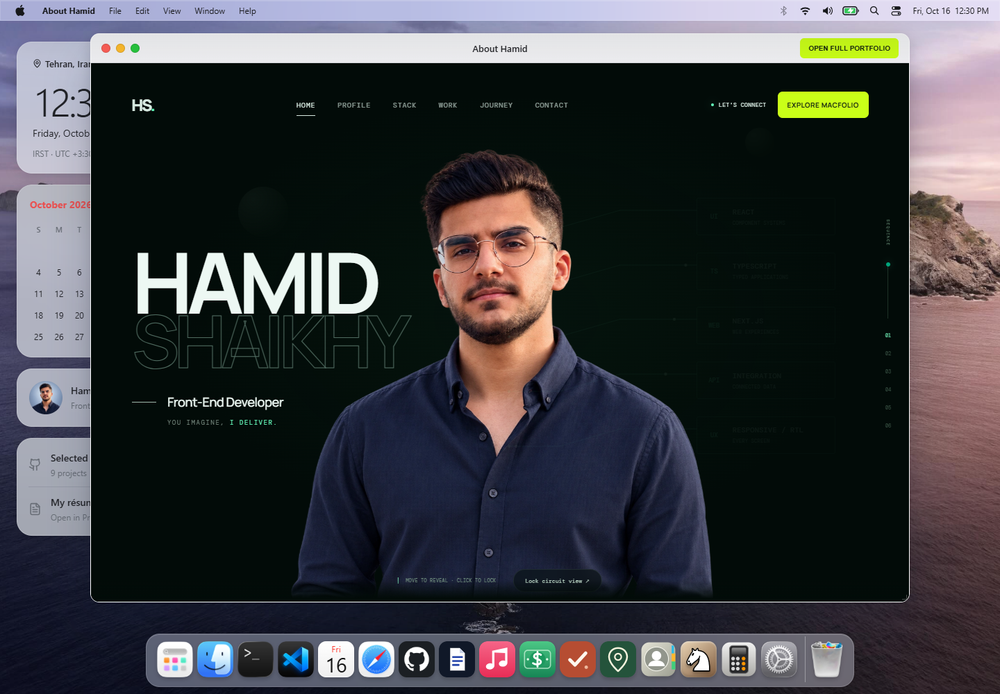](docs/screenshots/portfolio-about.png)

پورتفولیو در **About Hamid** باز می‌شود؛ با **Open full portfolio** می‌توانید نسخهٔ مستقل را در تب جدید ببینید.

macfolio معرفی، پروژه‌ها و ابزارهای روزمره را در محیطی الهام‌گرفته از macOS و iOS کنار هم می‌گذارد. پنجره‌ها را جابه‌جا کنید، برنامه‌ای را جست‌وجو کنید یا در گوشی از چیدمان مخصوص لمس استفاده کنید. Safari از Dock باز می‌شود و پورتفولیو را در Favorites دارد.

<a id="gallery"></a>

## گالری تصاویر

تصاویر از خود برنامه ثبت شده‌اند؛ با کلیک روی هرکدام، نسخهٔ کامل را ببینید.

### پورتفولیوی تعاملی

پرتره با حرکت نشانگر آشکار می‌شود و پروژه‌ها و سابقه با اسکرول تغییر می‌کنند. نسخهٔ گوشی و تبلت هم این حرکت‌ها را دارند.

| پرترهٔ الکترونیکی | نمونه‌کارها |
| :---: | :---: |
| [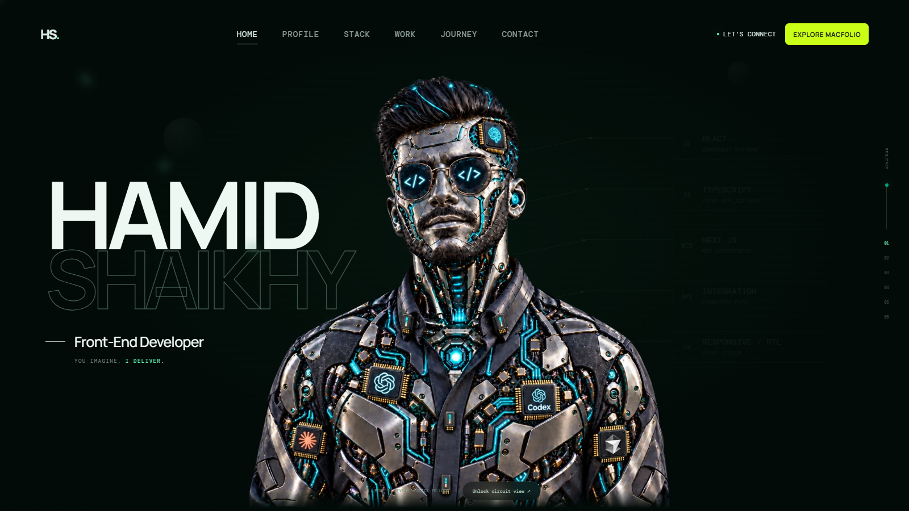](docs/screenshots/portfolio-electronic.png) | [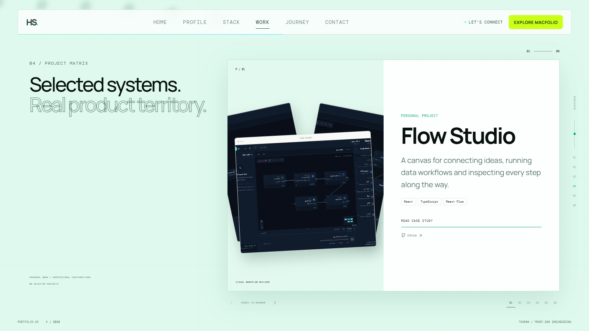](docs/screenshots/portfolio-work.png) |

### پروژه‌ها و فضای کار

GitHub داخلی و گالری پروژه‌ها، تصاویر واقعی محصولات را همراه توضیح نقش و نتیجهٔ کار نمایش می‌دهند.

| GitHub داخلی | گالری پروژه‌ها |
| :---: | :---: |
| [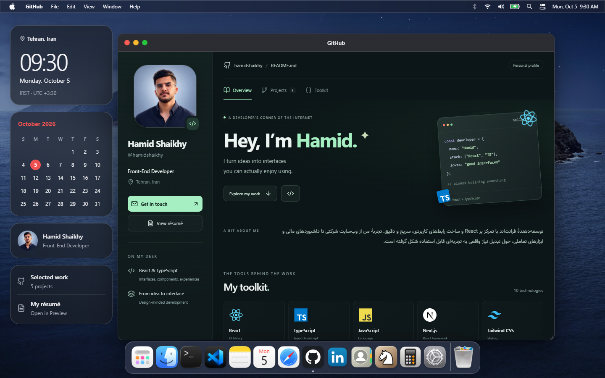](docs/screenshots/github-desktop.png) | [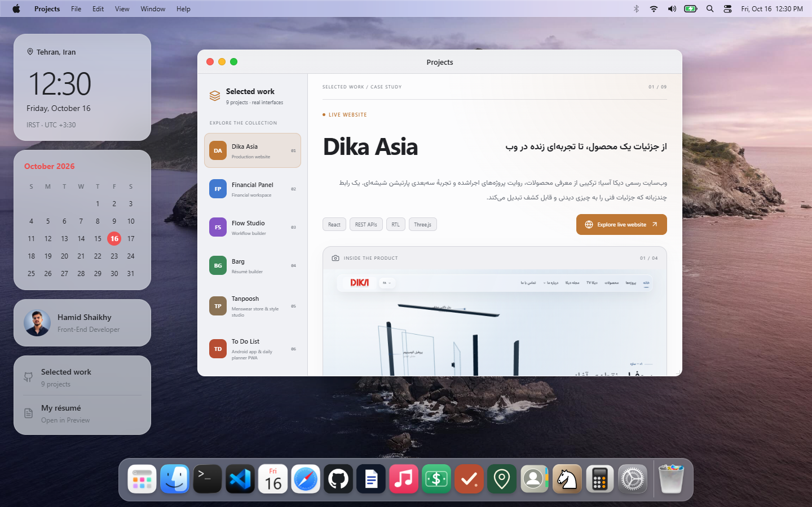](docs/screenshots/projects-desktop.png) |

| تقویم | ویرایشگر کد | شطرنج |
| :---: | :---: | :---: |
| [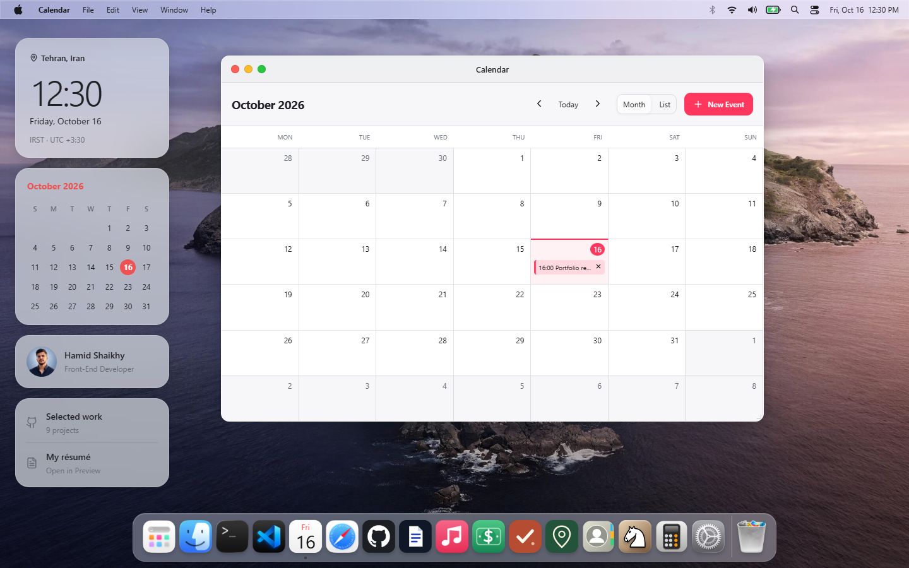](docs/screenshots/calendar-light.png) | [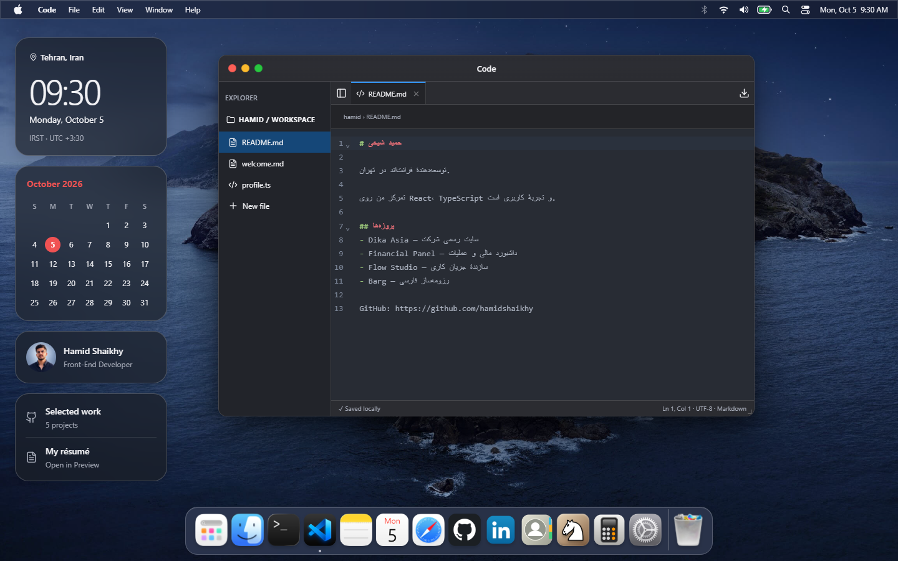](docs/screenshots/workspace-desktop.png) | [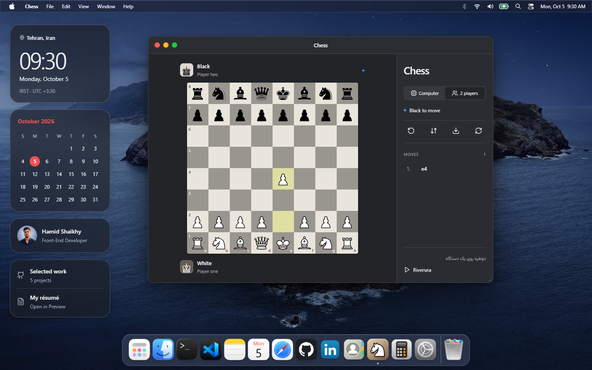](docs/screenshots/chess-desktop.png) |

### گوشی

| صفحهٔ خانه | پورتفولیو در About | تماس و فوتر |
| :---: | :---: | :---: |
| [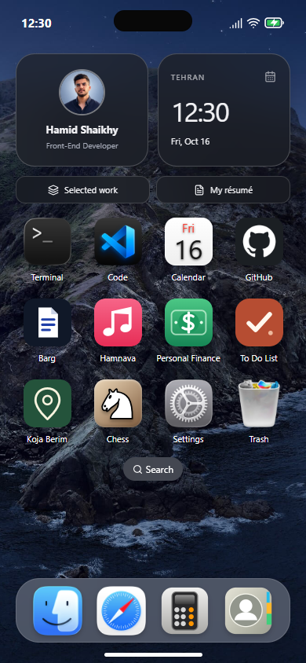](docs/screenshots/mobile-home.png) | [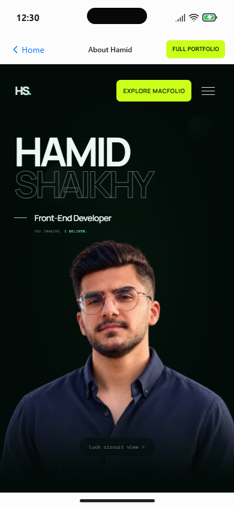](docs/screenshots/portfolio-about-mobile.png) | [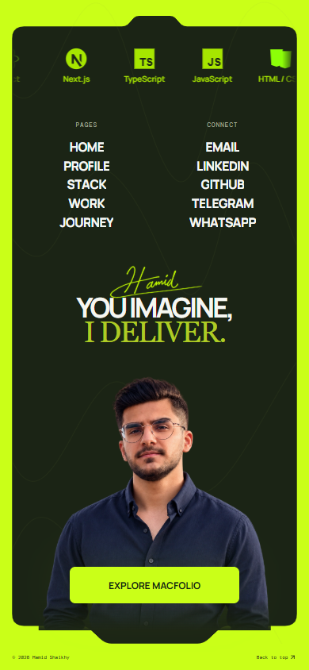](docs/screenshots/portfolio-mobile-contact.png) |

## امکانات

- **محیط دسکتاپ:** جابه‌جایی، تغییر اندازه و کوچک‌کردن پنجره‌ها؛ Dock، Spotlight، تم روشن و تیره و انتخاب والپیپر.
- **پورتفولیو:** پرترهٔ تعاملی، معرفی، ابزارها، ده پروژه با مطالعهٔ موردی، سابقهٔ توسعهٔ وب و اپ و راه‌های تماس.
- **رزومه:** نمایش PDF در Preview با بندانگشتی، زوم و دریافت اصل فایل.
- **فضای کار:** Finder، فایل‌های متنی در ویرایشگر کد، Terminal و Trash.
- **ابزارها:** تقویم با رویدادهای ذخیره‌شده، ماشین‌حساب با ورودی کیبورد، شطرنج و پخش موسیقی.
- **اپ‌های مستقل:** رزومه‌ساز برگ، همنوا، مدیریت مالی، To Do List و کجا بریم؛ از Dock و صفحهٔ خانهٔ گوشی باز می‌شوند و با **OPEN FULL** در تب مستقل هم در دسترس‌اند.
- **گوشی و تبلت:** برنامه‌های قابل لمس، منوی همبرگری پورتفولیو و صحنه‌های متحرک با اسکرول.

### اجرای مستقیم اپ‌ها

[رزومه‌ساز برگ](https://hamidshaikhy.vercel.app/apps/barg/) · [همنوا](https://hamidshaikhy.vercel.app/apps/hamnava/) · [مدیریت مالی](https://hamidshaikhy.vercel.app/apps/personal-finance/) · [To Do List](https://hamidshaikhy.vercel.app/apps/todo/) · [کجا بریم؟](https://hamidshaikhy.vercel.app/apps/koja-berim/)

سورس هر پنج اپ در `integrations/` نگهداری و جداگانه ساخته می‌شود؛ فقط هنگام بازکردن اپ بارگذاری می‌شود. لینک‌ها پس از انتشار این نسخه فعال می‌شوند.

<a id="start"></a>

## اجرای محلی

Node.js نسخهٔ ۲۲٫۱۳ یا جدیدتر؛ `npm ci` وابستگی‌های پنج اپ را هم نصب می‌کند:

```bash
npm ci
npm run dev
```

برنامه در [localhost:4173](http://localhost:4173) باز می‌شود. بک‌اند یا کلید API لازم ندارد؛ پخش موسیقی همنوا و دریافت کاشی‌های تازهٔ نقشه و مسیر در کجا بریم به اینترنت نیاز دارند.

```bash
npm run build    # خروجی در dist/
npm run preview
```

### بررسی و تست

```bash
npm test
npx tsc --noEmit --noUnusedLocals --noUnusedParameters
npm run test:browser:install
npm run test:browser
```

تست‌های مرورگر، پوسته، پورتفولیو و اجرای اپ‌ها را در Chromium و WebKit بررسی می‌کنند. نتایج ادغام، اندازه‌های بررسی‌شده و محدودیت تست روی دستگاه واقعی در [گزارش تست اپ‌ها](docs/INTEGRATION-QA.md) آمده است.

## ساختار پروژه

```text
integrations/      سورس پین‌شدهٔ پنج اپ مستقل
src/apps/          برنامه‌های محیط
src/components/    پنجره‌ها، Dock و کنترل‌های پوسته
src/portfolio/     پورتفولیو و صحنه‌های تعاملی
src/lib/           محتوا و منطق مشترک
src/state/         وضعیت محیط با Zustand
public/assets/     تصاویر، لوگوها، قلم‌ها و رزومه
src/test/          تست‌های واحد
tests/browser/     تست‌های مرورگر
```

React و TypeScript رابط را می‌سازند؛ Vite بسته‌بندی، PDF.js نمایش رزومه و CodeMirror ویرایش کد را انجام می‌دهند.

<a id="docs"></a>

## مستندات و تغییر محتوا

| موضوع | فایل |
| :--- | :--- |
| هویت و پروژه‌های محیط | [src/lib/content.ts](src/lib/content.ts) |
| متن و پروژه‌های پورتفولیو | [src/portfolio/content.ts](src/portfolio/content.ts) |
| پورتفولیو و تنظیم انتشار | [docs/PORTFOLIO.md](docs/PORTFOLIO.md) |
| معماری پروژه | [docs/ARCHITECTURE.md](docs/ARCHITECTURE.md) |
| سورس، ساخت و به‌روزرسانی پنج اپ | [docs/INTEGRATIONS.md](docs/INTEGRATIONS.md) |
| نتایج تست و هزینهٔ بارگذاری اپ‌ها | [docs/INTEGRATION-QA.md](docs/INTEGRATION-QA.md) |
| بررسی‌ها و محدودیت تست | [docs/QA.md](docs/QA.md) |

یادداشت‌ها، فایل‌ها و تنظیمات در مرورگر همان دستگاه ذخیره می‌شوند. تصاویر README از خود برنامه ثبت شده‌اند؛ برای بازتولیدشان از `npm run screenshots` و `npm run screenshots:portfolio` استفاده کنید.

## سازنده و مجوز

**حمید شیخی** · [GitHub](https://github.com/hamidshaikhy) · [LinkedIn](https://www.linkedin.com/in/hamid-shaikhy/) · [Email](mailto:hamidshaikhy1382@gmail.com)

کد با مجوز [MIT](LICENSE) ارائه شده است. اعتبارها و مجوزهای تصاویر، موسیقی و برندها در [ATTRIBUTIONS.md](ATTRIBUTIONS.md) آمده‌اند.
