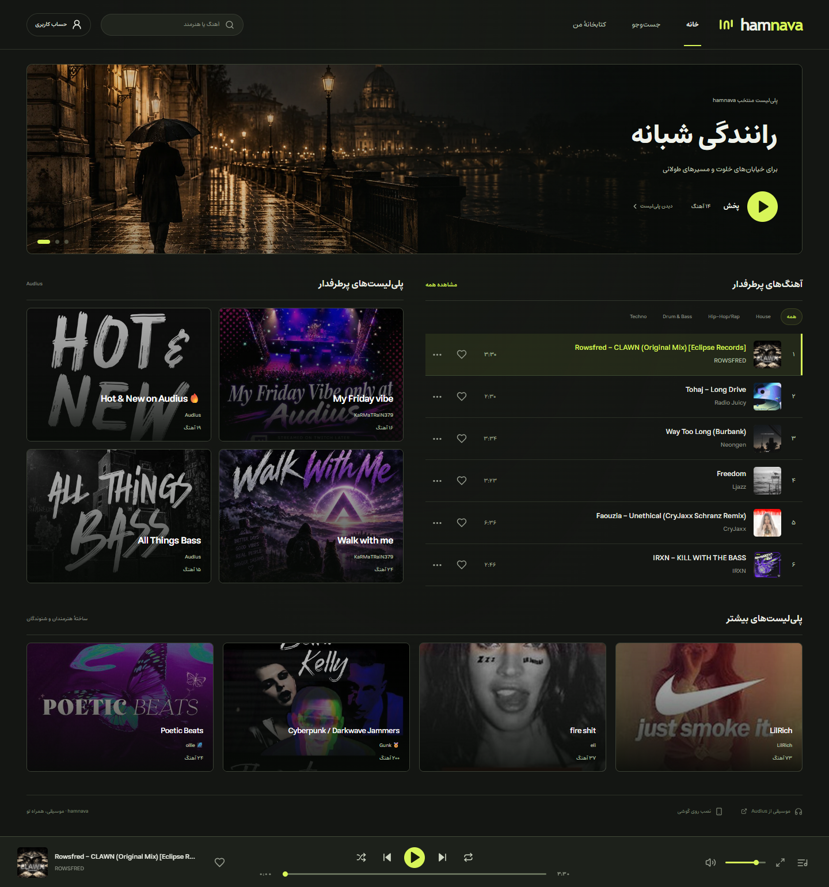
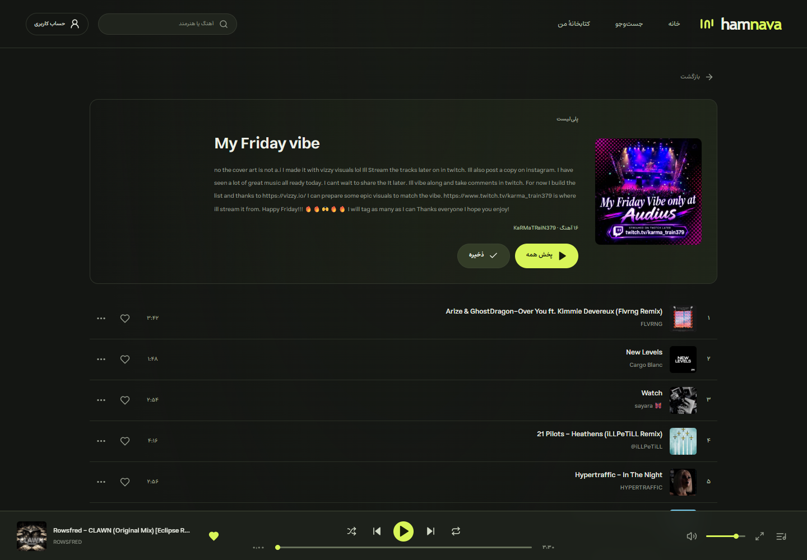
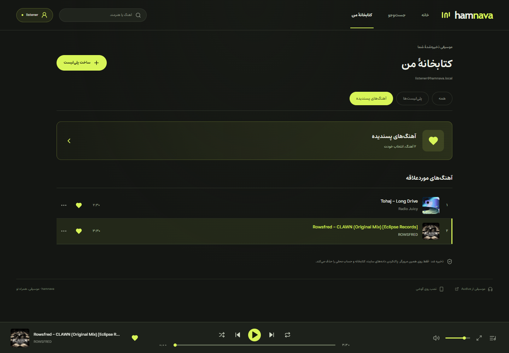
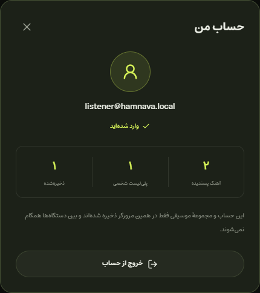
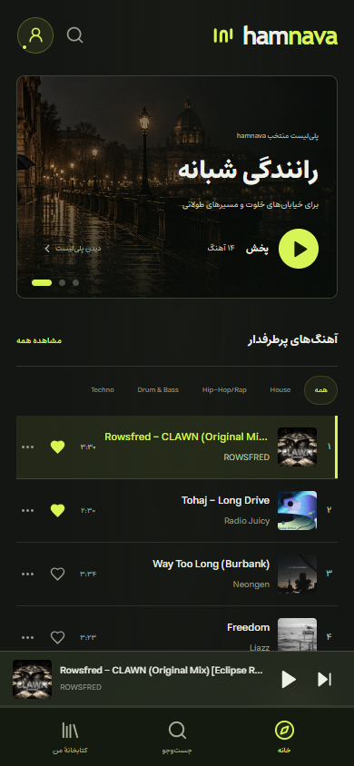

<div align="center">

# hamnava · هم‌نوا

**موسیقی، همراه تو.**

پخش‌کنندهٔ موسیقی با رابط فارسی، چیدمان راست‌چین و تم تیرهٔ لیمویی؛ یک **PWA (Progressive Web App)**، یا وب‌اپلیکیشن پیش‌رونده، با موسیقی و پلی‌لیست‌های واقعی Audius.

[نمایش تصویری](#نمایش-تصویری) · [امکانات](#امکانات) · [تکنولوژی‌ها](#تکنولوژی‌ها) · [شروع سریع](#شروع-سریع) · [ساختار پروژه](#ساختار-پروژه)

</div>



بنر «رانندگی شبانه» گلچین داخلی hamnava از آهنگ‌های واقعی است. پلی‌لیست‌های Audius با **نام، کاور، توضیحات و نام سازندهٔ اصلی** نمایش داده می‌شوند؛ اطلاعات انگلیسی ترجمه نمی‌شوند.

## نمایش تصویری

این پنج تصویر از اجرای واقعی برنامه در مرورگر و با اطلاعات زندهٔ Audius ثبت شده‌اند. حساب و مجموعهٔ شخصی داخل تصاویر، برای نمایش امکانات ساخته شده‌اند. برای دیدن جزئیات، روی هر تصویر کلیک کنید.

| جزئیات پلی‌لیست | کتابخانهٔ من |
| --- | --- |
| [](docs/screenshots/02-playlist.png) | [](docs/screenshots/03-collection.png) |
| اطلاعات اصلی سرویس، پخش همه و ذخیرهٔ پلی‌لیست. | دسترسی به پسندیده‌ها، پلی‌لیست‌های شخصی و ذخیره‌شده‌ها. |

| پروفایل | نمای موبایل |
| --- | --- |
| <a href="docs/screenshots/04-profile.png"></a> | <a href="docs/screenshots/05-mobile.png"></a> |
| اطلاعات حساب و آمار مجموعه با رنگ‌های خوانا. | هدر، ناوبری پایین و کنترل پخش مناسب صفحه‌های کوچک. |

## امکانات

- **موسیقی واقعی:** آهنگ‌های پرطرفدار، جست‌وجوی آهنگ و هنرمند، پلی‌لیست‌های عمومی و پخش آهنگ‌های در دسترس Audius.
- **پخش پیوسته:** کنترل پخش و مکث، جابه‌جایی زمان، صدا، پخش تصادفی، تکرار، صف پخش و کلید فاصله؛ پخش هنگام تغییر صفحه ادامه دارد.
- **مجموعهٔ شخصی:** پسندیدن آهنگ، ذخیرهٔ پلی‌لیست، ساخت و تغییر نام مجموعه، افزودن و حذف آهنگ؛ تاریخچهٔ شنیدن و جست‌وجوهای اخیر در بخش جست‌وجو.
- **حساب اختیاری:** ورود و ثبت‌نام محلی؛ مجموعهٔ مهمان هنگام ثبت‌نام به حساب جدید منتقل می‌شود. رمزها با salt و PBKDF2-SHA-256 ذخیره می‌شوند.
- **نصب روی گوشی:** PWA با فونت و آیکون محلی، پخش‌کنندهٔ موبایل و کنترل‌های Media Session در مرورگرهای پشتیبانی‌شده.

**محدودهٔ ذخیره‌سازی:** حساب و مجموعه‌ها فقط در همین مرورگر، در IndexedDB ذخیره می‌شوند؛ ورود سروری و همگام‌سازی بین دستگاه‌ها وجود ندارد. پاک‌کردن داده‌های سایت، این اطلاعات را حذف می‌کند.

**آفلاین:** رابط برنامه و اطلاعات ذخیره‌شده در نسخهٔ production قابل دسترسی‌اند؛ آهنگ‌ها دانلود یا کش نمی‌شوند. پخش به اینترنت و دسترسی به Audius نیاز دارد. پخش پس‌زمینه و کنترل‌های صفحهٔ قفل به مرورگر و سیستم‌عامل بستگی دارند.

## تکنولوژی‌ها

| تکنولوژی | کاربرد در hamnava |
| --- | --- |
| **React 19 + TypeScript** | ساخت رابط، اجزای مشترک و مدیریت وضعیت با تایپ‌های مشخص |
| **Vite** | اجرای محیط توسعه و ساخت نسخهٔ production |
| **CSS + Lucide React + Estedad** | تم تیرهٔ لیمویی، چیدمان واکنش‌گرا و راست‌چین، آیکون‌ها و فونت فارسی |
| **Audius API + Fetch API** | دریافت آهنگ‌ها، جست‌وجو و اطلاعات اصلی پلی‌لیست‌ها |
| **HTMLAudioElement + Media Session API** | پخش صوت، صف آهنگ‌ها و کنترل‌های رسانه‌ای مرورگر |
| **IndexedDB + localStorage** | ذخیرهٔ محلی حساب، کتابخانه، اطلاعات کاتالوگ و شناسهٔ نشست |
| **Web Crypto API** | هش‌کردن رمز با PBKDF2-SHA-256 و salt اختصاصی |
| **Web App Manifest + Service Worker + Cache API** | نصب PWA و دسترسی آفلاین به رابط برنامه |
| **Node.js Test Runner + Playwright + fake-indexeddb** | تست منطق برنامه، ذخیره‌سازی و رابط مرورگر |

**PWA بودن یعنی چه؟** hamnava از طریق سایت باز می‌شود و در مرورگرهای پشتیبانی‌شده روی صفحهٔ اصلی گوشی یا دسکتاپ نصب می‌شود؛ سپس در پنجره‌ای مستقل اجرا می‌شود. در آیفون از Safari و گزینهٔ **Share → Add to Home Screen** و در اندروید از گزینهٔ نصب مرورگر استفاده کنید. رابط برنامه پس از آماده‌شدن کش آفلاین در دسترس است؛ پخش موسیقی همچنان به اینترنت نیاز دارد.

## شروع سریع

Node.js نسخهٔ ۲۲ یا بالاتر:

```sh
npm install
npm run dev
```

آدرس محلی چاپ‌شده در ترمینال را باز کنید. دریافت اطلاعات عمومی به کلید API نیاز ندارد؛ تنظیمات اختیاری در [.env.example](.env.example) هستند. کلید محرمانه یا bearer token را در متغیرهای `VITE_` قرار ندهید.

```sh
npm test            # تست‌های داده، حساب و ارتباط با API
npm run test:ui     # تست رابط با Google Chrome
npm run build      # ساخت برنامه و service worker
npm run preview    # بررسی نسخهٔ production و PWA
```

تست‌های رابط به Google Chrome نصب‌شده نیاز دارند و نمایش اطلاعات اصلی API، خوانایی رنگ‌ها، ثبت‌نام و بازیابی حساب، و چیدمان موبایل را بررسی می‌کنند. این تست‌ها از پاسخ‌های کنترل‌شده استفاده می‌کنند؛ تصاویر README از API زنده گرفته شده‌اند.

برای انتشار روی Vercel، پروژه را با تنظیم **Vite**، دستور ساخت `npm run build` و پوشهٔ خروجی `dist` وارد کنید. بک‌اند جداگانه لازم نیست. نصب و service worker را با نسخهٔ production و HTTPS یا localhost بررسی کنید.

## ساختار پروژه

| مسیر | مسئولیت |
| --- | --- |
| `src/App.tsx` | صفحه‌های خانه، جست‌وجو، کتابخانه، پلی‌لیست و حساب |
| `src/api.ts` · `src/model.ts` | دریافت اطلاعات Audius، حفظ اطلاعات اصلی و منطق مجموعه‌ها |
| `src/db.ts` | حساب، نشست و ذخیره‌سازی محلی |
| `src/usePlayer.ts` · `src/Player.tsx` | چرخهٔ پخش، صف و کنترل‌های صوتی |
| `src/components.tsx` · `src/style.css` | اجزای مشترک، لوگو و چیدمان واکنش‌گرا |
| `public/` · `scripts/` | آیکون‌ها، تصویر بنر، ساخت آیکون و کش رابط آفلاین |
| `tests/` | تست‌های منطق و رابط مرورگر |

موسیقی و کاورهای کاتالوگ متعلق به هنرمندان و [Audius](https://audius.co) هستند. تصویر بنر به‌صورت محلی همراه برنامه است؛ مجوز فونت Estedad در [public/licenses](public/licenses/Estedad-OFL.txt) قرار دارد.
