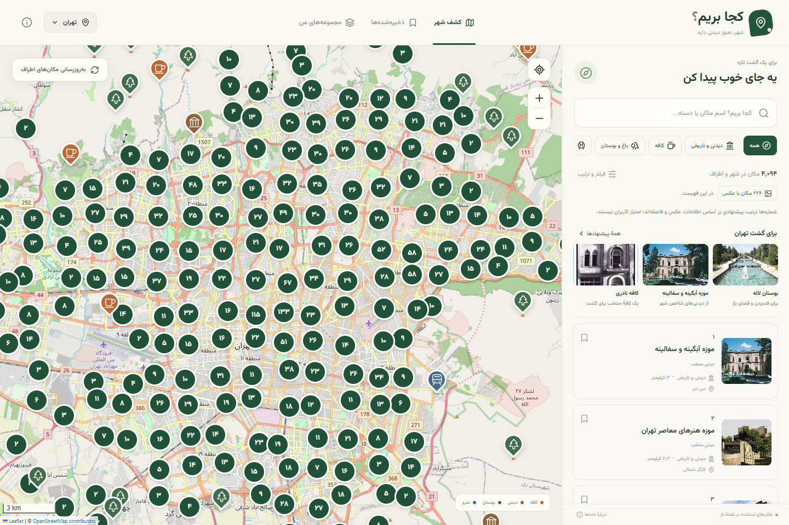
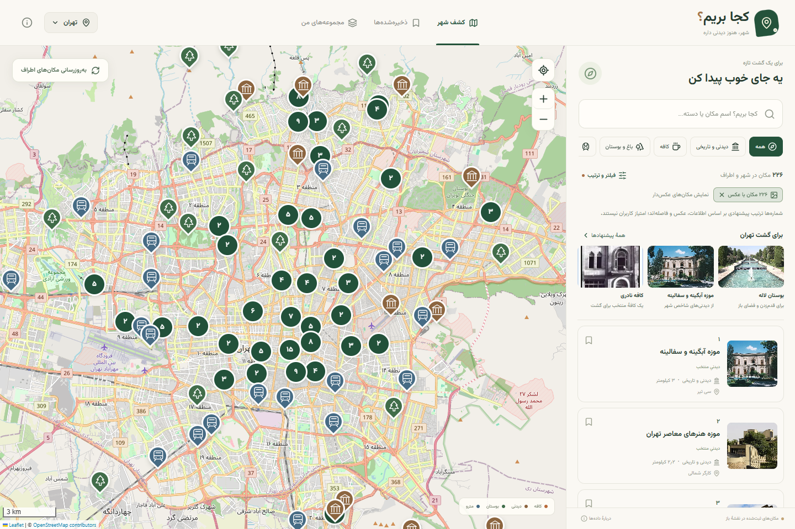
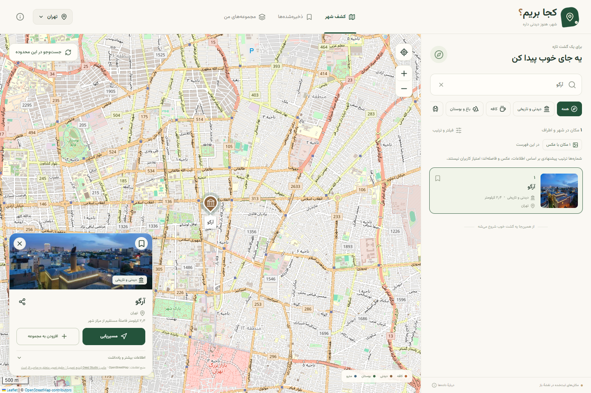
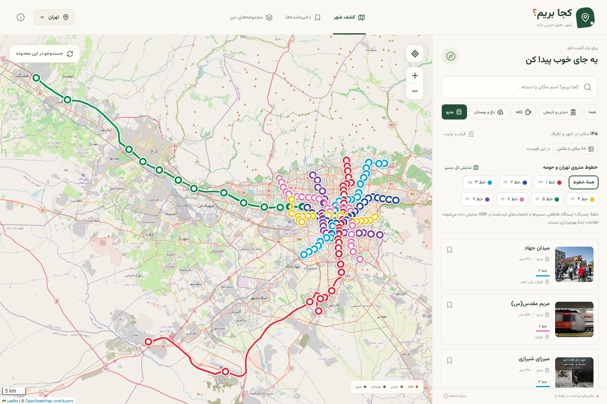
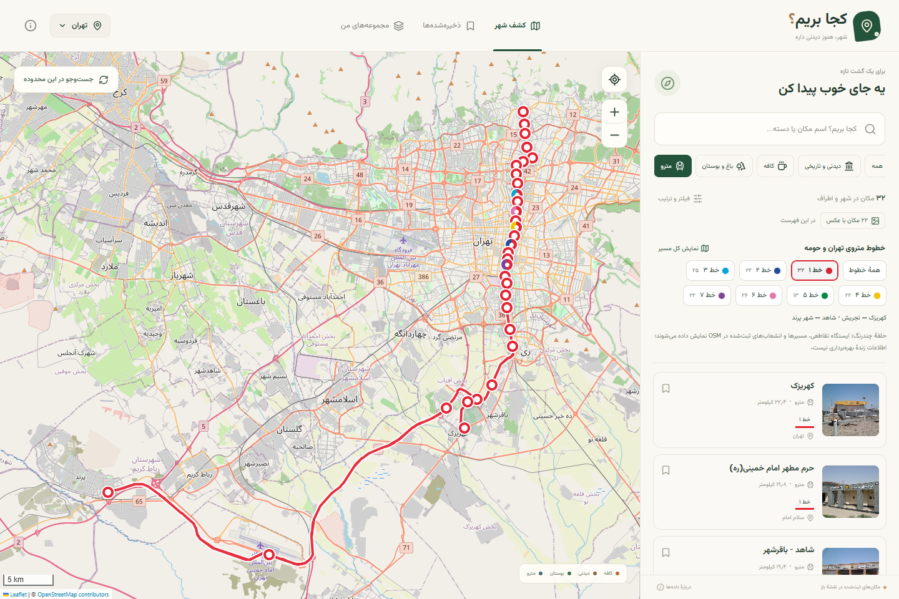
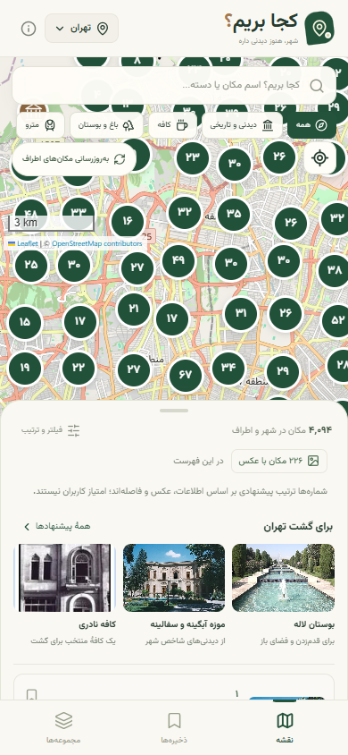
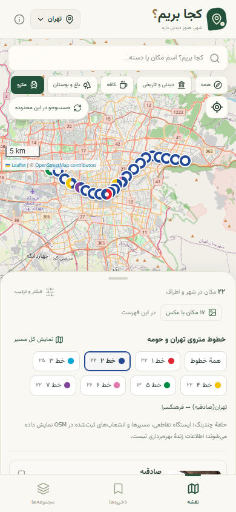
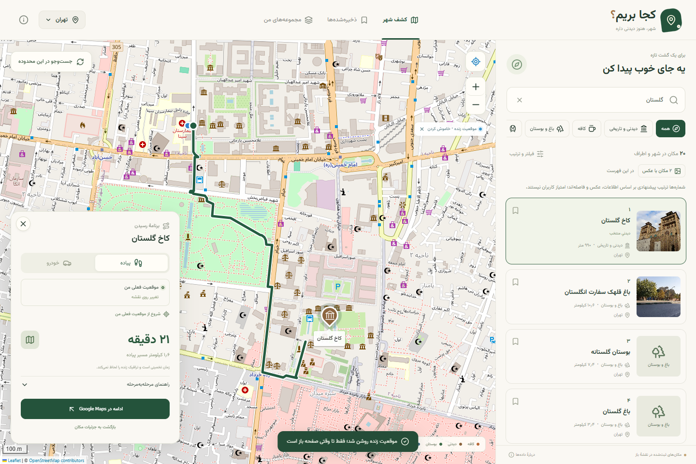

<h1 align="center">Koja Berim · کجا بریم؟</h1>

<p align="center">
  دیدنی‌های شهر، کافه‌ها و مسیرهای مترو را روی یک نقشهٔ فارسی کشف کنید؛<br>
  با پیشنهادهای گشت، عکس مکان‌ها و مجموعه‌های شخصی.
</p>

<p align="center">
  
  
  
  
  
  
</p>

<p align="center">
  <a href="#gallery">تصاویر برنامه</a> ·
  <a href="#features">امکانات</a> ·
  <a href="#start">اجرای محلی</a> ·
  <a href="#data">منابع داده</a> ·
  <a href="#architecture">معماری</a> ·
  <a href="#checks">آزمون‌ها</a>
</p>

[](docs/screenshots/discover-desktop.png)

**تصاویر این صفحه اسکرین‌شات واقعی برنامه‌اند.** نمای موبایل با اندازهٔ ۳۹۰ × ۸۴۴ در Chrome شبیه‌سازی شده است. داده‌ها از فهرست محلی پروژه و منابع عمومی دریافت شده‌اند.

کجا بریم یک وب‌اپ فارسی با React، TypeScript و Vite است. می‌توانید روی نقشه مکان پیدا کنید، عکس و اطلاعاتش را ببینید، آن را ذخیره کنید و برای گشت‌های بعدی مجموعه بسازید. اجرای پیش‌فرض به حساب کاربری، کلید API یا WebGL نیاز ندارد.

| کشف شهر | برنامه‌ریزی گشت | متروی تهران |
| :--- | :--- | :--- |
| جست‌وجو، دسته‌بندی، عکس و پیشنهاد | ذخیرهٔ مکان، مجموعه، یادداشت و مسیر | هفت خط رنگی، ایستگاه‌ها، انشعاب‌ها و تقاطع‌ها |

<a id="gallery"></a>
## تصاویر برنامه

برای دیدن تصویر کامل، روی آن کلیک کنید.

### مکان‌ها و عکس‌ها

| فهرست مکان‌های عکس‌دار | جزئیات موزه آرگو |
| :---: | :---: |
| [](docs/screenshots/photos-desktop.png) | [](docs/screenshots/place-desktop.png) |
| عکس‌های بررسی‌شده، پیشنهادهای متنوع و ترتیب پیشنهادی | اطلاعات ثبت‌شده، ذخیره، اشتراک‌گذاری و انتخاب مقصد |

### شبکهٔ مترو

| همهٔ خطوط تهران و حومه | انتخاب خط یک |
| :---: | :---: |
| [](docs/screenshots/metro-desktop.png) | [](docs/screenshots/metro-line-desktop.png) |
| مسیر جغرافیایی خطوط و نشان چندرنگ برای ایستگاه‌های تقاطعی | فیلتر خط، فهرست مرتب ایستگاه‌ها و نمایش کل مسیر |

### نسخهٔ موبایل

| کشف شهر | خط دو مترو |
| :---: | :---: |
| [](docs/screenshots/discover-mobile.png) | [](docs/screenshots/metro-mobile.png) |

### موقعیت زنده و مسیریابی

[](docs/screenshots/route-desktop.png)

در این تصویر، دسترسی موقعیت زنده فعال است و مختصات مبدا با ابزار آزمایش مرورگر در تهران شبیه‌سازی شده است؛ موقعیت واقعی کاربر نیست. مسیر پیاده تا کاخ گلستان از سرویس واقعی مسیریابی دریافت شده: حدود ۱٫۶ کیلومتر و ۲۱ دقیقه. خط مسیر ساختگی نیست. تصاویر نقشه پس از بارگذاری تمام کاشی‌های قابل مشاهده ثبت شده‌اند.

<a id="features"></a>
## امکانات اصلی

- **نقشهٔ بدون کلید:** Leaflet با کاشی‌های OpenStreetMap و سرویس پشتیبان OSM France؛ خوشه‌بندی نشان‌ها، زوم و تمرکز روی مکان.
- **کشف مکان:** دیدنی و تاریخی، موزه، کافه، باغ و بوستان، طبیعت و مترو؛ جست‌وجوی نام و نام جایگزین، فیلتر فاصله، محدودهٔ نقشه و عکس.
- **پوشش تهران:** ۴٬۰۹۶ رکورد خام شامل ۱٬۱۲۴ کافه؛ بام تهران، توچال، دربند و دیدنی‌های شمال و غرب شهر نیز در فهرست هستند. نمایش پیش‌فرض محدودیت شعاع ندارد.
- **عکس مکان‌ها:** ۲۲۶ مکان در فهرست ادغام‌شدهٔ فعلی تهران عکس دارند؛ با شمارنده، فیلتر عکس و لینک منبع. مکان بدون عکس معتبر فقط نماد دسته را نمایش می‌دهد.
- **متروی تهران و حومه:** هفت خط با رنگ مستقل، ۱۴۵ ایستگاه نقشه‌برداری‌شده و ۱۷ ایستگاه تقاطعی؛ شامل انشعاب‌های ثبت‌شدهٔ فرودگاهی و حومه‌ای.
- **پیشنهاد گشت:** انتخاب‌های متنوع داخل فهرست و ترتیب بر اساس اطلاعات، عکس، منتخب‌بودن و فاصله؛ شماره‌ها امتیاز کاربران نیستند.
- **مجموعه‌های شخصی:** ذخیره و حذف مکان، ساخت و ویرایش مجموعه، یادداشت و خروجی/ورودی JSON؛ نگهداری محلی در IndexedDB.
- **موقعیت و مسیر:** موقعیت زنده با اجازهٔ کاربر، انتخاب مبدا، مسیر پیاده و خودرو، مسافت و زمان تخمینی و راهنمای فارسی؛ نیازمند دسترسی به سرویس مسیریابی.
- **چند شهر:** تهران، اصفهان، شیراز، تبریز، رشت، مشهد، یزد و کاشان؛ امکان جست‌وجوی شهرهای دیگر.
- **وب‌اپ نصب‌شدنی:** پوستهٔ آفلاین، فونت محلی، رابط راست‌چین و فهرست کشویی موبایل. کاشی‌های تازه، جست‌وجو و مسیریابی به اینترنت نیاز دارند.

<a id="start"></a>
## اجرای محلی

به Node.js **۲۲ یا جدیدتر** نیاز دارید:

```bash
git clone https://github.com/hamidshaikhy/koja-berim.git
cd koja-berim
npm ci
npm run dev
```

نشانی چاپ‌شده توسط Vite را باز کنید؛ معمولاً `http://localhost:5173` است. حالت پیش‌فرض بدون فایل `.env` اجرا می‌شود.

| فرمان | کاربرد |
| :--- | :--- |
| `npm run dev` | اجرای محیط توسعه |
| `npm test` | اجرای ۴۵ آزمون خودکار |
| `npm run build` | بررسی TypeScript، ساخت `dist/` و تولید service worker |
| `npm run preview` | پیش‌نمایش خروجی انتشار |

نصب با pnpm نیز از طریق `corepack enable` و `pnpm install --frozen-lockfile` ممکن است. برای موقعیت مکانی مرورگر، از localhost یا HTTPS استفاده کنید.

### انتشار

خروجی `dist/` روی میزبان استاتیک قابل انتشار است. در Vercel، Framework را Vite و پوشهٔ خروجی را `dist` قرار دهید. مسیرها نسبی‌اند؛ برای استقرار در زیرمسیر می‌توانید `APP_BASE` را هنگام ساخت تنظیم کنید.

### اتصال اختیاری نشان

جست‌وجو، اطلاعات مکان و مسیریابی نشان از طریق درگاه سرور در `api/neshan.mjs` قابل استفاده‌اند. `.env.example` را کپی و کلید سروری فعال‌شدهٔ خودتان را تنظیم کنید؛ کلید سروری نباید در متغیرهای `VITE_` باشد. سرویس عکس از نشان پیاده‌سازی نشده و اتصال دارای کلید، در این نسخه به‌صورت زنده آزمایش نشده است. [راهنمای فنی و تنظیمات](docs/technical-details.md) جزئیات را توضیح می‌دهد.

<a id="data"></a>
## منابع داده و محدودهٔ پوشش

- **مکان‌ها و خطوط مترو:** دادهٔ OpenStreetMap، استخراج منطقه‌ای Geofabrik و روابط مسیر مترو. تاریخ استخراج تهران: ۱۴ اکتبر ۲۰۲۶، ساعت ۲۰:۲۱ UTC. رکوردهای تکراری در رابط ادغام می‌شوند؛ تعداد خام با تعداد مکان‌های قابل نمایش یکسان نیست.
- **عکس و توضیح:** Wikimedia/Wikipedia و عکس‌های بررسی‌شده از منابع گردشگری و معماری؛ از جمله ToIran، امرداد، کارناوال و Deed Studio. پیوند منبع و اطلاعات حقوق هر تصویر در جزئیات مکان حفظ می‌شود.
- **پوشش:** فهرست مکان‌ها و وضعیت بهره‌برداری ایستگاه‌ها کامل یا زنده تضمین نشده است. پوشش عکس فعلی به هدف هزار مکان نرسیده است. ساعات کار و اطلاعات کسب‌وکارها ممکن است تغییر کرده باشند.
- **مسیر و فاصله:** فاصلهٔ کارت‌ها مستقیم است؛ مسیر واقعی از سرویس مسیریابی می‌آید. زمان مسیر ترافیک زنده ندارد و دسترسی سرویس‌های عمومی به اتصال اینترنت بستگی دارد.
- **ذخیره‌ها:** روی همان مرورگر نگهداری می‌شوند؛ ورود سروری و همگام‌سازی ابری وجود ندارد. برای نگهداری نسخهٔ مستقل، پشتیبان JSON بگیرید.

<a id="architecture"></a>
## معماری و ساختار پروژه

```text
src/
├── App.tsx              رابط، جست‌وجو، جزئیات و مجموعه‌ها
├── MapView.tsx          بارگذاری تنبل نقشه
├── RasterMapView.tsx    Leaflet، نشان‌ها، مسیر و لایهٔ مترو
├── model.ts             مدل داده، دسته‌بندی، ادغام و فیلتر
├── api.ts               سرویس‌های عمومی و داده‌های محلی
├── neshan.ts            اتصال اختیاری نشان
└── storage.ts           IndexedDB و کش
public/data/            فهرست شهرها، مترو و اطلاعات عکس‌ها
public/photos/          تصاویر محلی با ارجاع به منبع
api/neshan.mjs          درگاه اختیاری سمت سرور
scripts/                واردکردن داده، عکس، آزمون و ساخت آفلاین
docs/screenshots/       اسکرین‌شات‌های واقعی دسکتاپ و موبایل
tests/core.ts           آزمون‌های مدل، داده و سرویس‌ها
```

شرح واردکردن داده‌ها، بازبینی عکس‌ها، تنظیمات نشان و محدودیت‌های سرویس‌ها در [مستندات فنی](docs/technical-details.md) آمده است.

<a id="checks"></a>
## آزمون‌ها و بررسی‌ها

**۴۵ آزمون خودکار و بیلد تولید موفق‌اند.** آزمون‌ها دسته‌بندی و مختصات، ادغام بدون حذف اطلاعات، پوشش تهران، هندسه و تقاطع خطوط مترو، منابع عکس و جلوگیری از بازگشت عکس‌های ردشده، پشتیبان، IndexedDB و سازگاری درگاه نشان را پوشش می‌دهند.

بررسی Chrome شامل بارگذاری نقشه با WebGL غیرفعال، سرویس پشتیبان کاشی، جست‌وجو و انتخاب مکان، عکس‌ها، هفت رنگ مترو، فیلتر خطوط و نمای موبایل بدون اسکرول افقی بوده است. بررسی مسیر با پاسخ نمونه انجام شده؛ نصب روی گوشی واقعی و سرویس نشان با کلید فعال بررسی نشده‌اند.

## مجوز

کد پروژه تحت [MIT](LICENSE) است. دادهٔ OSM متعلق به [مشارکت‌کنندگان OpenStreetMap](https://www.openstreetmap.org/copyright) و تحت ODbL است. حقوق عکس‌ها، فونت و داده‌های دیگر متعلق به صاحبان آن‌هاست؛ مجوز کد به تصاویر منتقل نمی‌شود. منبع و حقوق تصاویر در داده‌ها و رابط برنامه درج شده‌اند.
