<h1 align="center">Personal Finance · دفتر مالی شخصی</h1>

<p align="center">
  دخل‌وخرج، حساب‌ها و برنامه‌های مالی‌تان را در یک پنل فارسی و راست‌چین ببینید؛<br>
  با تقویم شمسی، نمودار مسیر پول و ذخیره‌سازی رمزگذاری‌شده در مرورگر.
</p>

<p align="center">
  
  
  
  
  
</p>

<p align="center">
  <a href="#gallery">تصاویر برنامه</a> ·
  <a href="#features">امکانات</a> ·
  <a href="#start">اجرای محلی</a> ·
  <a href="#demo">حساب دمو</a> ·
  <a href="#architecture">معماری</a> ·
  <a href="#checks">آزمون‌ها</a>
</p>

[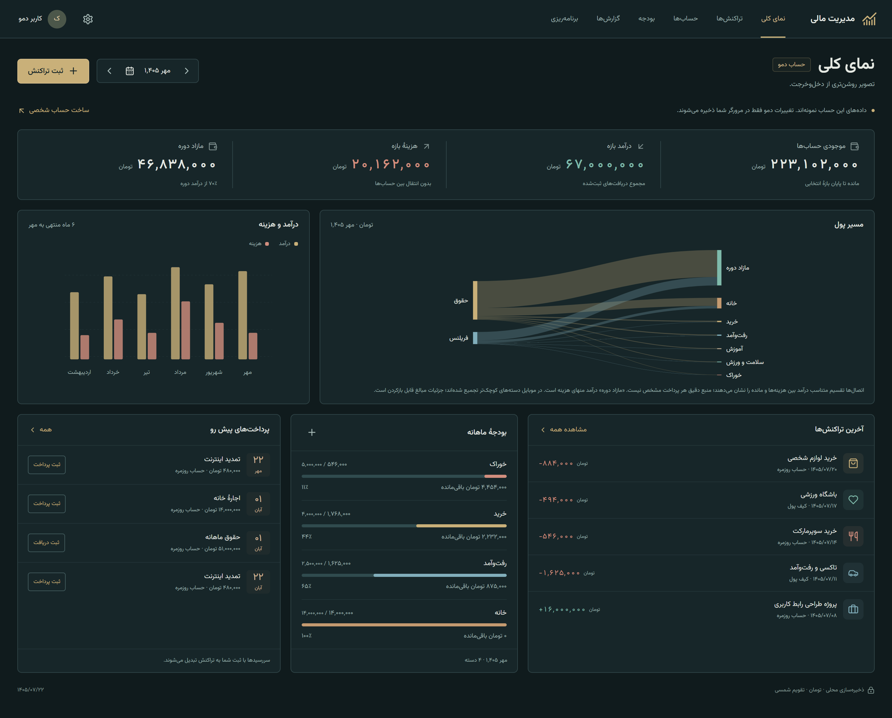](docs/screenshots/overview-desktop.png)

**پنل بالا یک اسکرین‌شات واقعی از برنامه است.** داده‌های آن متعلق به حساب نمایشی‌اند و اطلاعات مالی واقعی نیستند. رنگ‌بندی فعلی برنامه، نفتی و برنجی است؛ تصاویر با همان رابط اصلی ثبت شده‌اند.

این پروژه یک برنامهٔ وب استاتیک با React، TypeScript و Vite است. می‌توانید حساب‌های بانکی و نقدی را تعریف کنید، درآمد و هزینه ثبت کنید، بودجهٔ ماهانه تعیین کنید و برای پرداخت‌ها و پس‌انداز برنامه داشته باشید. برای اجرای آن به بک‌اند، اتصال به بانک یا کلید API نیاز ندارید. حساب‌ها و دفتر مالی روی همان مرورگر نگهداری می‌شوند.

| ثبت روزمره | دیدن وضعیت مالی | برنامه‌ریزی |
| :--- | :--- | :--- |
| درآمد، هزینه، انتقال بین حساب‌ها و تاریخ شمسی | موجودی، مقایسهٔ شش ماه، سنکی و خروجی CSV | بودجهٔ دسته‌ها، سررسیدهای تکراری و هدف‌های پس‌انداز |

<a id="gallery"></a>

## تصاویر برنامه

برای دیدن نسخهٔ کامل هر تصویر، روی آن کلیک کنید. تمام تصاویر با Chrome و داده‌های محلی دمو گرفته شده‌اند؛ نسخهٔ موبایل در نمای شبیه‌سازی‌شدهٔ مرورگر ثبت شده است.

### ورود و ثبت تراکنش

| ورود به دفتر مالی | ثبت و ویرایش تراکنش |
| :---: | :---: |
| [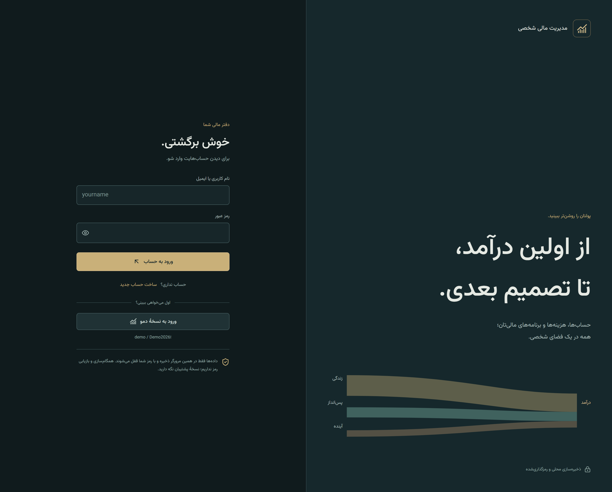](docs/screenshots/login-desktop.png) | [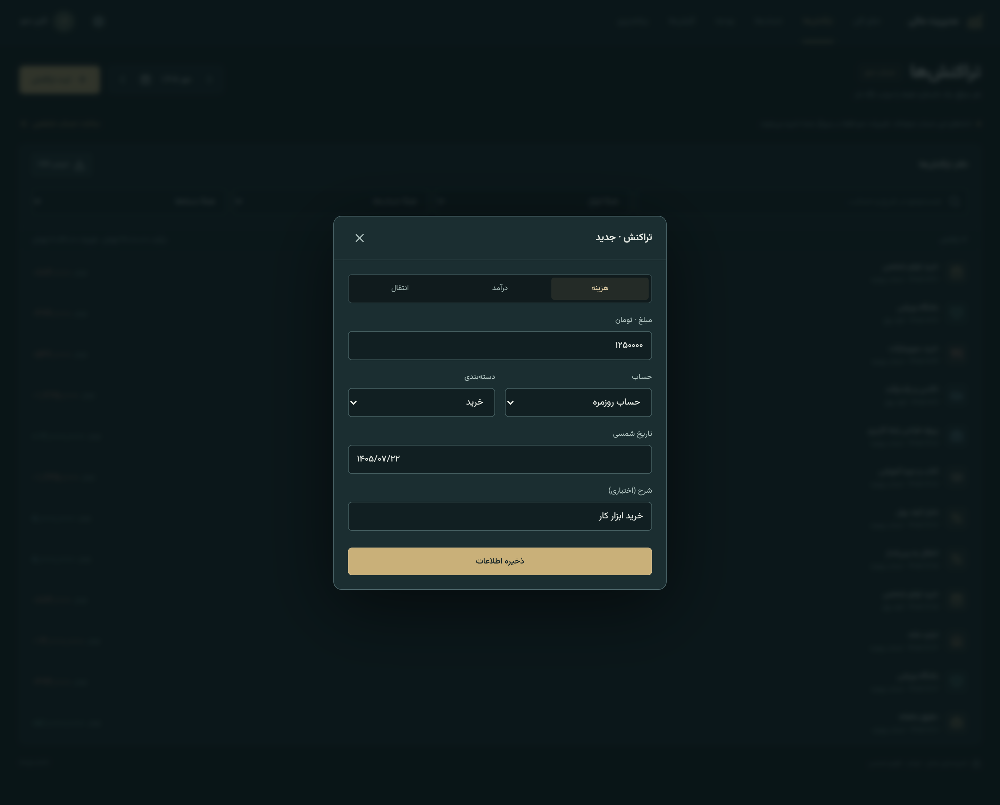](docs/screenshots/transaction-editor-desktop.png) |
| ساخت حساب محلی، ورود با رمز و امتحان‌کردن نسخهٔ نمایشی | انتخاب درآمد، هزینه یا انتقال؛ ثبت مبلغ، تاریخ و شرح |

### گزارش‌ها و گردش حساب

| گزارش مالی | دفتر تراکنش‌ها |
| :---: | :---: |
| [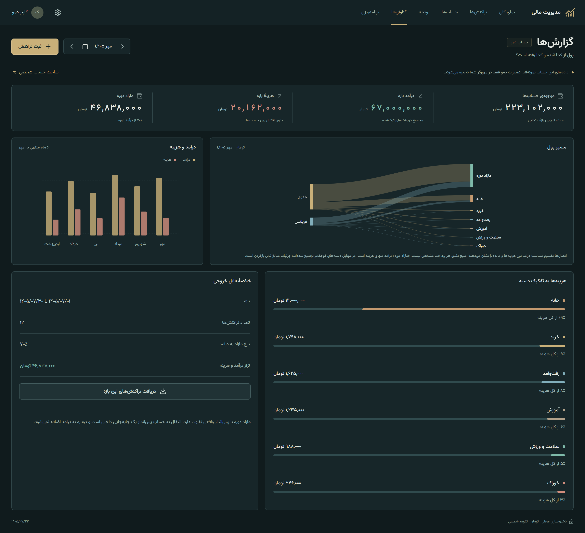](docs/screenshots/reports-desktop.png) | [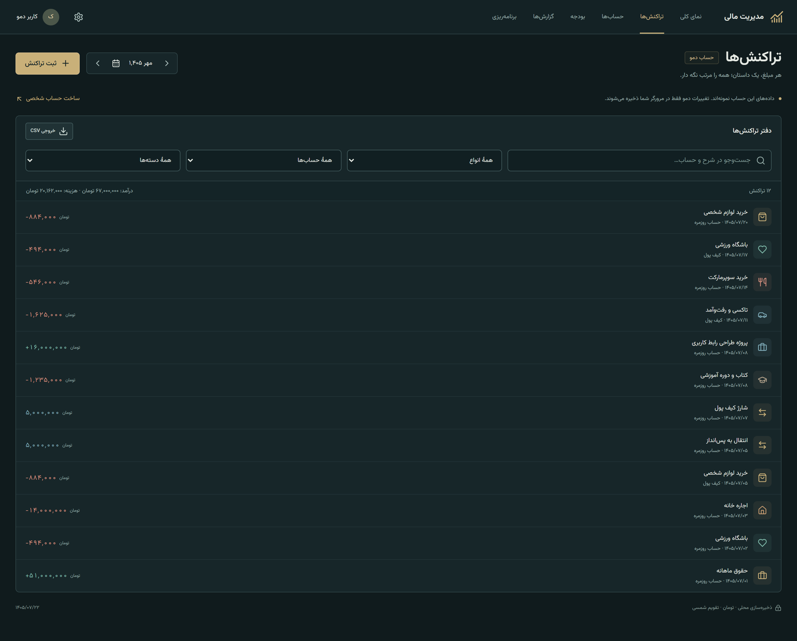](docs/screenshots/transactions-desktop.png) |
| انتخاب ماه یا بازهٔ دلخواه، بررسی دسته‌ها و دریافت CSV | جست‌وجوی شرح، فیلترکردن دفتر و ویرایش هر ردیف |

### حساب‌ها و بودجه

| حساب‌ها | بودجهٔ ماهانه |
| :---: | :---: |
| [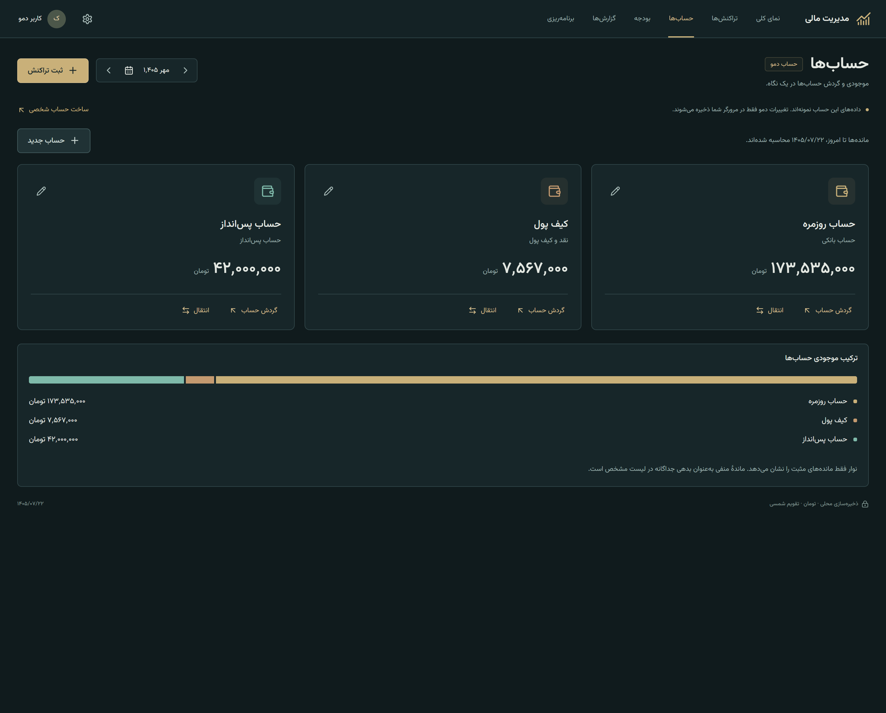](docs/screenshots/accounts-desktop.png) | [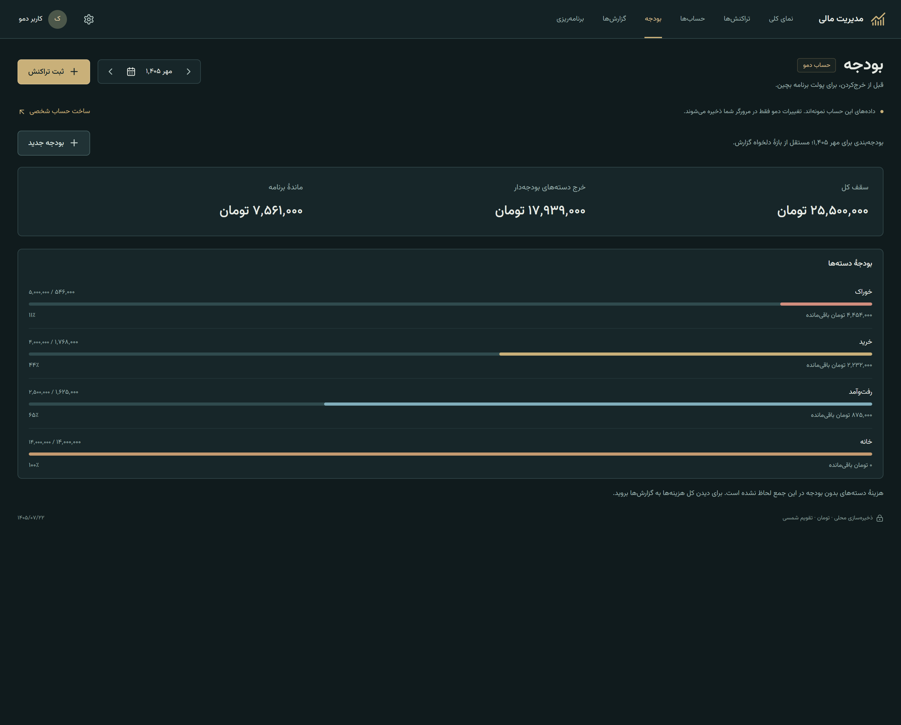](docs/screenshots/budgets-desktop.png) |
| موجودی مستقل، انتقال داخلی و نمایش ماندهٔ مثبت یا بدهی | سقف خرج هر دسته، میزان مصرف و مشخص‌بودن عبور از بودجه |

### سررسیدها و پس‌انداز

| پرداخت‌ها و دریافت‌های برنامه‌ریزی‌شده | هدف‌های پس‌انداز |
| :---: | :---: |
| [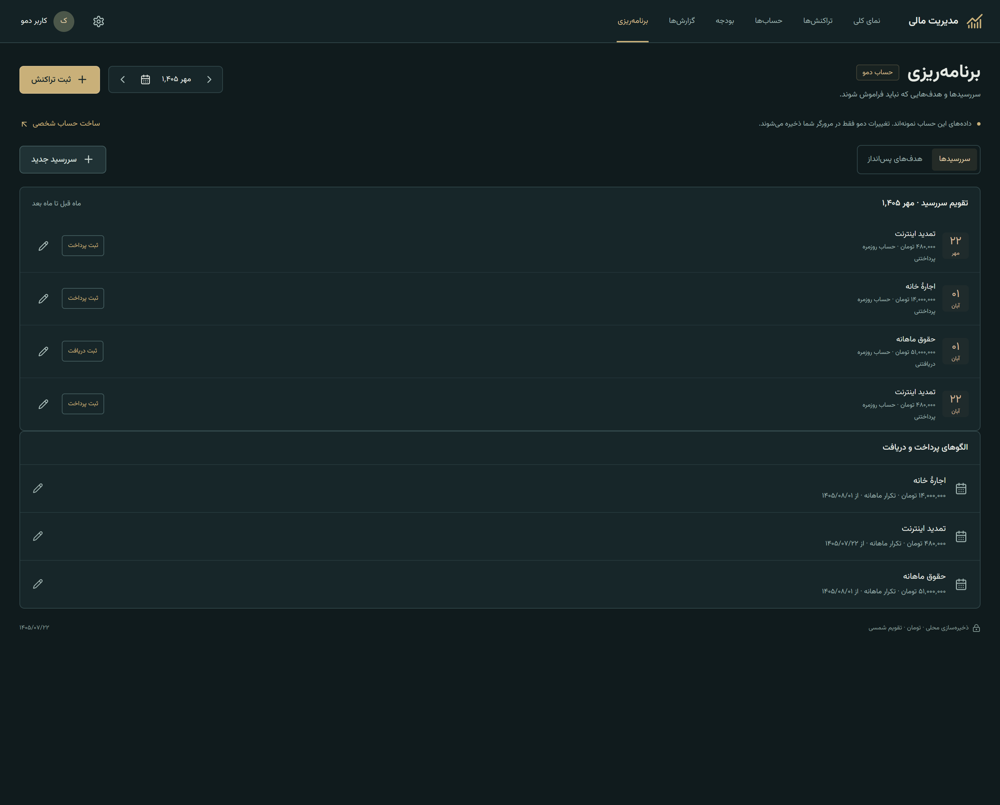](docs/screenshots/scheduled-desktop.png) | [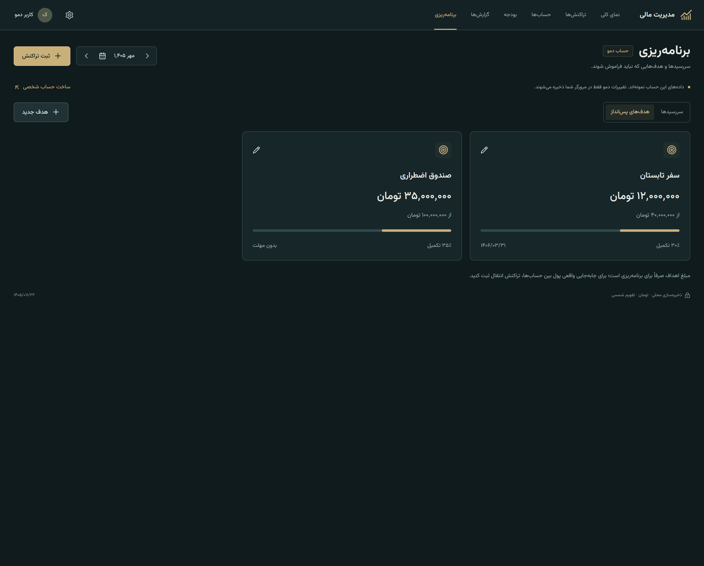](docs/screenshots/goals-desktop.png) |
| ساخت الگوی یک‌باره یا ماهانه و ثبت پرداخت با اقدام کاربر | تعیین مبلغ هدف، مبلغ کنارگذاشته‌شده و مهلت اختیاری |

### نسخهٔ موبایل

| نمای کلی | تراکنش‌ها | فرم ثبت |
| :---: | :---: | :---: |
| [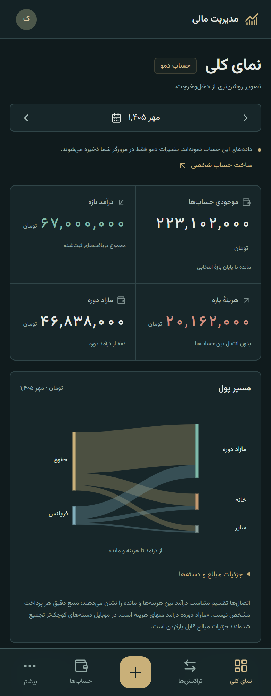](docs/screenshots/overview-mobile.png) | [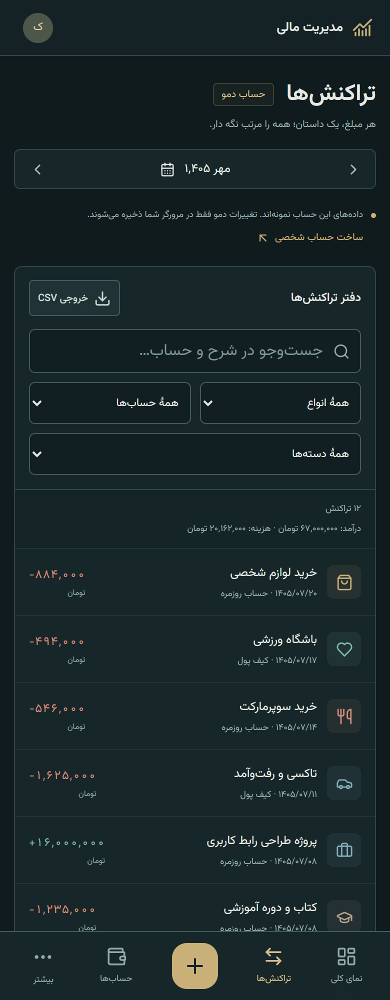](docs/screenshots/transactions-mobile.png) | [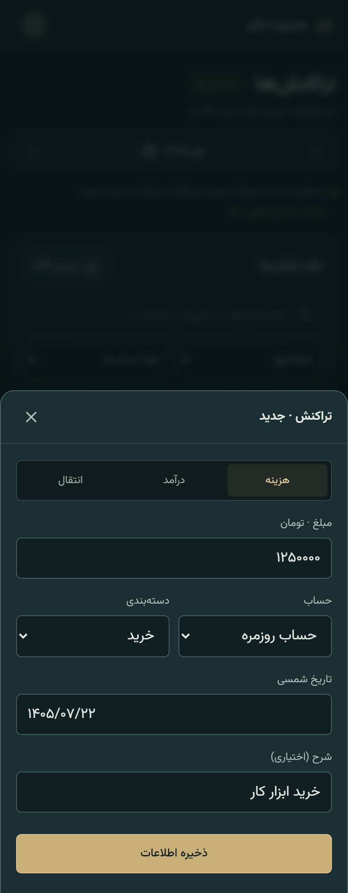](docs/screenshots/transaction-editor-mobile.png) |

در موبایل، نمودار مسیر پول دسته‌های کوچک را در «سایر» جمع می‌کند؛ جزئیات همهٔ دسته‌ها و مبالغ قابل بازکردن است. ناوبری پایین صفحه و فرم‌های متناسب با عرض کم، همان دفتر مالی را در دسترس نگه می‌دارند.

<details>
<summary>تصویر تنظیمات و ابزارهای نگهداری داده</summary>

[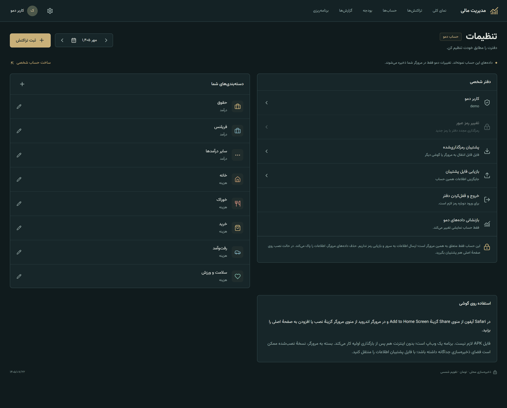](docs/screenshots/settings-desktop.png)

</details>

<a id="features"></a>

## امکانات اصلی

- **دفتر تراکنش‌ها:** ایجاد، ویرایش و حذف درآمد، هزینه و انتقال؛ مبلغ صحیح به تومان؛ پذیرش رقم‌های فارسی و عربی؛ شرح و تاریخ شمسی؛ جست‌وجو و فیلتر.
- **حساب‌ها:** بانکی، نقدی، پس‌انداز و اعتباری؛ موجودی اولیه و ماندهٔ مستقل؛ انتقال از یک حساب به حساب دیگر؛ نمایش بدهی برای ماندهٔ منفی.
- **دسته‌بندی‌ها:** دستهٔ جدا برای درآمد و هزینه، رنگ قابل انتخاب و مدیریت دسته‌های شخصی. حذف حساب یا دستهٔ استفاده‌شده در سوابق با بررسی ارجاع‌ها انجام می‌شود.
- **بودجه‌بندی:** سقف ماهانه برای دستهٔ هزینه، مبلغ مصرف‌شده، مانده و تشخیص عبور از سقف؛ بر اساس ماه شمسی.
- **گزارش‌ها:** مقایسهٔ درآمد و هزینهٔ شش ماه، نمودار سنکی، هزینهٔ هر دسته، نرخ مازاد و بازهٔ زمانی دلخواه؛ خروجی CSV.
- **برنامه‌ریزی:** پرداخت یا دریافت یک‌باره و ماهانه، تاریخ پایان اختیاری، وضعیت ثبت‌شده یا پرداخت‌نشده و جلوگیری از ثبت دوبارهٔ همان سررسید.
- **هدف‌های پس‌انداز:** مبلغ هدف، مبلغ تخصیص‌یافته، درصد پیشرفت و تاریخ دلخواه؛ مستقل از گردش واقعی حساب‌ها.
- **حساب‌های محلی:** ثبت‌نام، ورود، تغییر نام و رمز، خروج و قفل‌کردن دفتر؛ اطلاعات هر حساب جداست.
- **پشتیبان و بازیابی:** فایل پشتیبان رمزگذاری‌شده با رمز مستقل؛ بازیابی در حساب محلی فعال و انتقال دستی دفتر به مرورگر یا دستگاه دیگر.
- **وب‌اپ نصب‌شدنی:** manifest، آیکن‌ها و service worker برای کش‌کردن پوستهٔ برنامه و استفادهٔ آفلاین پس از بارگذاری اولیه.

<a id="start"></a>

## اجرای محلی

به Node.js **۲۲٫۱۲ یا جدیدتر** و npm نیاز دارید. فایل `.nvmrc` شاخهٔ ۲۲ را مشخص می‌کند. این نسخه با Node.js ۲۴ نیز بررسی شده است.

```bash
git clone https://github.com/hamidshaikhy/personal-finance.git
cd personal-finance
npm ci
npm run dev
```

نشانی چاپ‌شده توسط Vite را باز کنید؛ معمولاً `http://localhost:5173` است. نصب وابستگی‌ها به اینترنت نیاز دارد؛ داده‌های مالی و فونت برنامه در زمان اجرا به سرویس خارجی وابسته نیستند.

| فرمان | کاربرد |
| :--- | :--- |
| `npm run dev` | اجرای Vite برای توسعه |
| `npm test` | اجرای آزمون‌های مالی، امنیت، سنکی و رندر |
| `npm run build` | بررسی TypeScript، ساخت نسخهٔ انتشار و تولید service worker |
| `npm run preview` | دیدن نسخهٔ ساخته‌شدهٔ `dist/` در محیط محلی |
| `npm run capture:screenshots` | بازتولید گالری با مرورگر و حساب‌های نمایشی جدا |

Web Crypto به محیط امن نیاز دارد: از `localhost` یا HTTPS استفاده کنید. نشانی HTTP شبکهٔ محلی روی گوشی ممکن است API رمزگذاری را در اختیار برنامه نگذارد؛ برای بررسی روی دستگاه دیگر از HTTPS استفاده کنید.

<a id="demo"></a>

## حساب دمو و اولین استفاده

در صفحهٔ ورود، دکمهٔ **«ورود به نسخهٔ دمو»** را بزنید. ورود دستی هم ممکن است:

```text
Username: demo
Password: Demo2026!
```

دمو شامل شش ماه تراکنش نمونه با درآمد و هزینهٔ متنوع، سه حساب، بودجه‌ها، سررسیدها و دو هدف پس‌انداز است. دمو در هر مرورگر جداگانه ذخیره می‌شود و تغییرات آن باقی می‌ماند. در تنظیمات می‌توانید آن را با تأیید خودتان بازنشانی کنید. نسخهٔ قدیمی دمو یک بار مبالغ نمونهٔ دست‌نخورده را به ارقام متنوع به‌روز می‌کند.

برای استفادهٔ شخصی:

1. حساب محلی جدید بسازید؛ دفتر آن خالی است و دادهٔ دمو واردش نمی‌شود.
2. در «حساب‌ها»، حساب بانکی یا کیف پول و موجودی اولیه را تعریف کنید.
3. اولین درآمد یا هزینه را با مبلغ تومان و تاریخ شمسی ثبت کنید.
4. برای دسته‌های پرمصرف بودجه بگذارید و سررسیدها یا هدف‌های خود را اضافه کنید.
5. از تنظیمات، فایل پشتیبان رمزگذاری‌شده دریافت کنید.

نام کاربری از حروف و رقم‌های لاتین تشکیل می‌شود و می‌تواند شبیه ایمیل باشد؛ ارسال ایمیل یا تأیید آدرس وجود ندارد. حساب کاربری در همین مرورگر ساخته می‌شود.

<a id="data"></a>

## قواعد مالی و معنی نمودارها

| موضوع | رفتار برنامه |
| :--- | :--- |
| واحد مبلغ | تومانِ صحیح؛ مبلغ اعشاری یا ریال به‌عنوان واحد جدا پشتیبانی نمی‌شود |
| انتقال داخلی | حساب مبدأ کم و مقصد زیاد می‌شود؛ درآمد، هزینه و دارایی کل افزایش نمی‌یابد |
| موجودی | موجودی اولیه به‌علاوهٔ گردش ثبت‌شده تا تاریخ مبنا |
| مازاد دوره | درآمد منهای هزینهٔ همان بازه؛ الزاماً موجودی حساب پس‌انداز نیست |
| سنکی | درآمدها در چپ، هزینه‌ها و مازاد در راست؛ ضخامت مسیرها متناسب با مبلغ |
| اتصال‌های سنکی | تقسیم متناسب مجموع‌ها برای نمایش؛ منبع دقیق هر خرید از داده‌های دفتر قابل تعیین نیست |
| کسری دوره | وقتی هزینه از درآمد بیشتر است، اختلاف با «برداشت از موجودی» نمایش داده می‌شود |
| بودجه و هدف | دادهٔ برنامه‌ریزی‌اند و خودشان تراکنش یا کسر موجودی ایجاد نمی‌کنند |
| سررسید | تنها با اقدام کاربر به تراکنش تبدیل می‌شود؛ برداشت خودکار وجود ندارد |
| تاریخ آینده | قابل ثبت است و فقط در بازهٔ مناسب محاسبه می‌شود؛ در رابط مشخص می‌شود |

محاسبات با عدد صحیح انجام می‌شوند و ورودی یا مجموع خارج از محدودهٔ امن رد می‌شود. برنامه پایان ماه‌های شمسی را برای تکرار سررسیدها رعایت می‌کند. شرح کامل و مثال‌ها در [قواعد مالی](docs/financial-rules.md) آمده است.

## نگهداری داده و امنیت حساب

دفتر هر حساب در IndexedDB با **AES-256-GCM** رمزگذاری می‌شود. کلید از رمز آن حساب، salt مستقل و **PBKDF2-SHA-256 با ۳۱۰٬۰۰۰ تکرار** مشتق می‌شود. ذخیرهٔ جدید IV تصادفی دارد و شناسهٔ حساب بخشی از دادهٔ احراز اصالت رمزگذاری است.

رمز و کلید رمزگشایی در storage ذخیره نمی‌شوند؛ کلید بازشده فقط در حافظهٔ صفحه می‌ماند و با خروج یا تازه‌کردن صفحه کنار گذاشته می‌شود. شمارهٔ بازبینی نیز جلوی جایگزینی بی‌خبر اطلاعات توسط یک تب قدیمی را می‌گیرد.

این سازوکار حفاظت محلی از فایل مالی است؛ احراز هویت سروری یا اتصال بانکی نیست. همگام‌سازی ابری و بازیابی رمز فراموش‌شده وجود ندارد. پاک‌کردن داده‌های مرورگر ممکن است دفتر را حذف کند. فایل پشتیبان با رمز مستقل برای نگهداری و انتقال داده در دسترس است؛ خروجی CSV فایل خوانا و بدون رمزگذاری است.

مرورگر و صفحهٔ بازشده باید قابل اعتماد باشند؛ افزونهٔ مخرب یا دستگاه آلوده می‌تواند خارج از حفاظت فایل ذخیره‌شده عمل کند. برای جزئیات، [مدل ذخیره‌سازی و امنیت](docs/security-and-storage.md) را ببینید.

<a id="architecture"></a>

## معماری و ساختار پروژه

```text
src/
├── App.tsx          صفحه‌ها، ناوبری، نشست و عملیات کاربر
├── Charts.tsx       سنکی دسکتاپ و موبایل، نمودار درآمد و هزینه
├── flow-layout.ts   هندسهٔ گره‌ها و مسیرهای متناسب سنکی
├── model.ts         مدل مالی، تقویم شمسی، محاسبات و دمو
├── db.ts            حساب‌های محلی، رمزگذاری، ذخیره و پشتیبان
├── Editors.tsx      فرم‌های تراکنش، حساب، بودجه، دسته، سررسید و هدف
├── ui.tsx           اجزای مشترک، دیالوگ‌ها، فهرست‌ها و خروجی فایل
├── palette.ts       رنگ‌های دسته‌ها و نگاشت رنگ‌های پیش‌فرض قدیمی
├── styles.css       رابط نفتی و برنجی، RTL و حالت موبایل
└── main.tsx         راه‌اندازی React، فونت و service worker
tests/               آزمون‌های مالی، امنیت، رندر و هندسهٔ سنکی
scripts/             ساخت کش آفلاین، اجرای آزمون و ثبت تصاویر
public/              manifest، آیکن‌ها و مجوز فونت
docs/                راهنماها، گزارش بررسی و اسکرین‌شات‌ها
```

رابط، مدل مالی و ذخیره‌سازی از هم جدا شده‌اند. توابع محاسباتی روی دفتر مالی کار می‌کنند؛ ذخیره‌سازی ابتدا داده را اعتبارسنجی و رمزگذاری می‌کند و بعد آن را می‌نویسد. [راهنمای معماری](docs/architecture.md) مسیر داده و نقش فایل‌ها را توضیح می‌دهد.

<a id="checks"></a>

## بررسی پروژه و بازتولید تصاویر

```bash
npm test
npm run build
```

در بررسی این نسخه، **۳۸ تست خودکار** موفق شدند. آزمون‌ها رقم‌های فارسی، تراز حساب، انتقال داخلی، تاریخ شمسی، سررسیدها، بودجه، حفاظت رمزگذاری، جداسازی حساب‌ها، پشتیبان، به‌روزرسانی دموی قدیمی و هندسهٔ سنکی را پوشش می‌دهند.

گالری شامل **۱۳ تصویر واقعی** از دسکتاپ و نمای موبایل است. اسکریپت ثبت تصاویر، ورود به دمو، متفاوت‌بودن ستون‌های ماه‌ها، نبود اسکرول افقی در نماهای ثبت‌شده و نبود خطای اجرایی مرورگر را نیز بررسی می‌کند. این بررسی، آزمون روی گوشی واقعی یا بررسی کامل رفتار کیبورد، نصب PWA و بازیابی آفلاین روی همهٔ دستگاه‌ها نیست. جزئیات در [گزارش بررسی](docs/verification.md) ثبت شده است.

برای بازتولید گالری، Chrome نصب‌شده یا Chromium مربوط به Playwright لازم است:

```bash
# اگر Chrome نصب نیست:
npx playwright install chromium

# ترمینال اول:
npm run dev

# ترمینال دوم:
npm run capture:screenshots
```

تصاویر در `docs/screenshots/` نوشته می‌شوند. اسکریپت از حساب و فضای ذخیره‌سازی آزمایشی جدا استفاده می‌کند. تاریخ ثابت تصاویر **۲۲ مهر ۱۴۰۵ / ۱۴ اکتبر ۲۰۲۶** است تا خروجی قابل تکرار باشد. انتخاب نشانی برنامه، تاریخ یا فایل اجرایی مرورگر در [راهنمای ثبت تصاویر](docs/screenshots.md) توضیح داده شده است.

<a id="deploy"></a>

## ساخت و انتشار

```bash
npm ci
npm run build
npm run preview
```

خروجی `dist/` برای یک میزبان استاتیک با HTTPS آماده است. روی Vercel یا میزبان مشابه، فرمان ساخت `npm run build` و پوشهٔ خروجی `dist` است. متغیر محیطی یا سرویس بک‌اند لازم نیست.

نسخهٔ فعلی برای مسیر ریشهٔ دامنه (`/`) تنظیم شده است. برای انتشار زیرمسیر، مانند GitHub Pages پروژه‌ای، باید base مربوط به Vite و مسیرهای manifest و service worker را هماهنگ کنید؛ [راهنمای انتشار](docs/deployment.md) جزئیات را دارد.

## مستندات تکمیلی

- [معماری و مسیر ذخیرهٔ یک تراکنش](docs/architecture.md)
- [قواعد مالی، تاریخ‌ها و نمودار مسیر پول](docs/financial-rules.md)
- [رمزگذاری، پشتیبان و محدودیت‌های ذخیرهٔ محلی](docs/security-and-storage.md)
- [نتیجهٔ آزمون‌ها و محدودهٔ بررسی مرورگر](docs/verification.md)
- [نحوهٔ بازتولید اسکرین‌شات‌ها](docs/screenshots.md)
- [ساخت، میزبانی و استفادهٔ آفلاین](docs/deployment.md)
- [مجوز و اعتبار وابستگی‌ها](THIRD_PARTY_NOTICES.md)

برای کد اصلی پروژه هنوز مجوز مستقلی انتخاب نشده و فایل `LICENSE` ندارد. مجوز فونت و وابستگی‌های اصلی در مستندات و فایل‌های همراه نگهداری شده‌اند.
