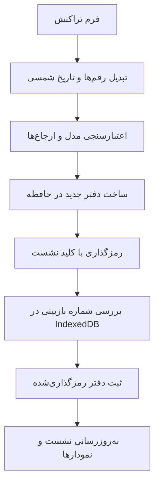

# معماری دفتر مالی

برنامه یک SPA استاتیک است. React رابط را نمایش می‌دهد، مدل TypeScript محاسبات را انجام می‌دهد و IndexedDB دفتر رمزگذاری‌شدهٔ هر حساب را نگه می‌دارد. بک‌اند یا پایگاه دادهٔ مرکزی وجود ندارد.

## مسیر یک تراکنش

موفقیت عملیات بعد از نوشتن داده اعلام می‌شود. اگر بازبینی ذخیره‌شده با نشست برابر نباشد، ذخیرهٔ تب قدیمی رد می‌شود.

## مسئولیت فایل‌ها

| فایل | مسئولیت |
| :--- | :--- |
| `src/model.ts` | انواع دفتر، تبدیل تاریخ، مبلغ، اعتبارسنجی، تراز، بودجه، سررسید، CSV و دمو |
| `src/db.ts` | کلید، رمزگذاری، حساب محلی، ذخیره، تغییر رمز و فایل پشتیبان |
| `src/App.tsx` | صفحهٔ فعال، بازهٔ گزارش، نشست و هماهنگی عملیات |
| `src/Editors.tsx` | فرم‌های شش نوع موجودیت و تحویل دفتر معتبر به لایهٔ ذخیره |
| `src/Charts.tsx` | نمایش SVG و تعامل با نمودارها |
| `src/flow-layout.ts` | جای‌گذاری گره‌ها و مسیرهای سنکی با مقیاس مشترک |
| `src/ui.tsx` | دیالوگ، ورودی، فهرست تراکنش، پیشرفت و دریافت فایل |
| `src/palette.ts` | پالت و نمایش رنگ‌های پیش‌فرض قدیمی با رنگ‌های فعلی |
| `scripts/build-sw.mjs` | تولید کش آفلاین بر اساس محتوای build |

## مدل داده

دفتر `Ledger` نام نمایشی و آرایه‌های `accounts`، `categories`، `transactions`، `budgets`، `scheduled` و `goals` را دارد. رابطه‌ها با شناسه‌های یکتا مشخص می‌شوند. تاریخ تراکنش در مدل ISO میلادی است؛ تبدیل شمسی هنگام ورودی و نمایش انجام می‌شود. همهٔ مبلغ‌ها عدد صحیح تومان‌اند.

نشست شامل کلید Web Crypto، دفتر بازشده و بازبینی است و فقط در حافظه نگهداری می‌شود. IndexedDB رکورد کاربر و ciphertext را دارد. reload برنامه را به صفحهٔ ورود برمی‌گرداند؛ ورود دوباره دفتر ذخیره‌شده را باز می‌کند.

فیلترها، فرم باز و صفحهٔ فعال حالت رابط‌اند. نمودارها از دفتر و بازهٔ انتخابی محاسبه می‌شوند؛ برای ظاهر نمودار عدد مالی جداگانه ساخته نمی‌شود.

## دمو و واکنش‌گرایی

`demoLedger` شش ماه دادهٔ نمونه نسبت به ماه فعلی می‌سازد. برای نسخه‌های قدیمی، `upgradeDemoLedger` فقط مبالغ منطبق با مشخصات نمونهٔ قبلی را به‌روز می‌کند. ارتقا با نشانگر نسخه و بررسی بازبینی ذخیره می‌شود؛ برای حساب واقعی اجرا نمی‌شود.

در دسکتاپ، سنکی همهٔ دسته‌ها را نمایش می‌دهد. در موبایل، نمودار فشرده و جزئیات بازشدنی استفاده می‌شوند. دیالوگ روی صفحهٔ کوچک پایین صفحه باز می‌شود. viewport و safe area در CSS در نظر گرفته شده‌اند. Vazirmatn در بستهٔ برنامه قرار دارد و از CDN دریافت نمی‌شود.
