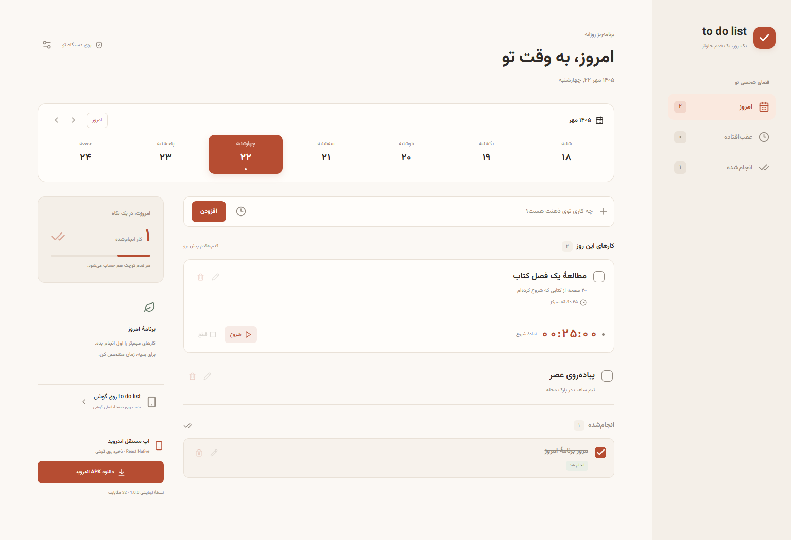
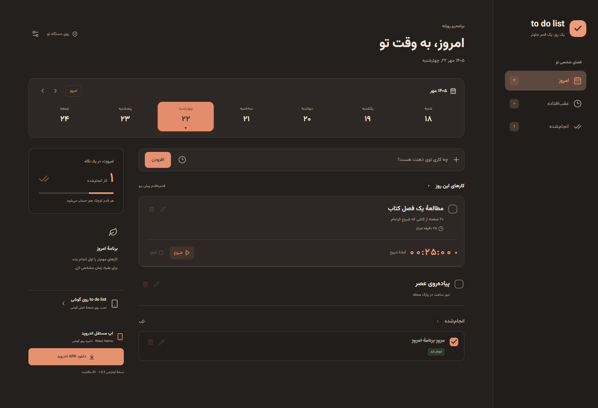
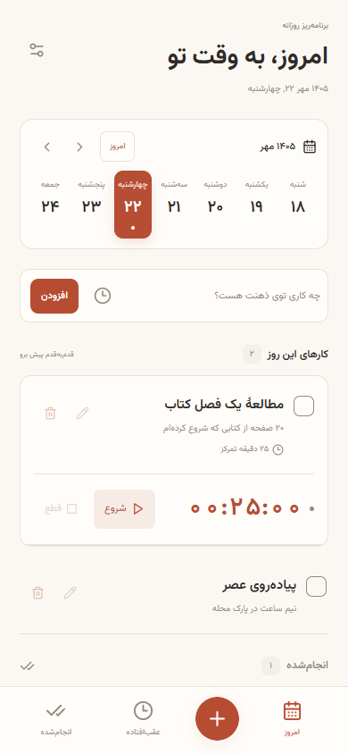

<div align="center">

# to do list

**برنامه‌ریز روزانهٔ فارسی؛ کارها، تقویم و تایمر تمرکز در یک فضای ساده.**


[تصاویر](#preview) · [امکانات](#features) · [فناوری‌ها](#stack) · [اجرای پروژه](#start)

</div>

یک برنامهٔ سبک برای مدیریت کارهای روزانه با رابط راست‌چین، تقویم شمسی و حالت روشن و تاریک در وب. نسخهٔ وب قابل نصب است و نسخهٔ مستقل اندروید با React Native ساخته شده؛ بدون حساب کاربری یا سرور. اطلاعات روی همان دستگاه ذخیره می‌شوند و میان وب و اندروید همگام‌سازی ندارند.

<a id="preview"></a>
## نگاهی به برنامه



<table>
  <tr><th>حالت تاریک</th><th>نمای موبایل</th></tr>
  <tr>
    <td width="70%"><a href="docs/screenshots/desktop-dark.png"></a></td>
    <td width="30%" align="center"><a href="docs/screenshots/mobile.png"></a></td>
  </tr>
</table>

هر سه تصویر از اجرای واقعی نسخهٔ وب با کارهای نمایشی گرفته شده‌اند.

<a id="features"></a>
## امکانات

- افزودن، ویرایش، حذف و تکمیل کارها؛ همراه یادداشت و تاریخ انجام.
- انتخاب روز از تقویم هفتگی و مشاهدهٔ کارهای عقب‌افتاده و انجام‌شده.
- تایمر اختیاری با شروع، مکث، ادامه و بازنشانی؛ تکمیل خودکار کار با پایان زمان.
- ذخیرهٔ محلی، پشتیبان JSON در وب، استفادهٔ آفلاین پس از بارگذاری و دانلود APK از داخل وب.

تایمر هنگام بازگشت به برنامه محاسبه می‌شود؛ زنگ هنگام بسته‌بودن برنامه تضمین نمی‌شود.

<a id="stack"></a>
## زبان‌ها و فناوری‌ها

| بخش | زبان‌ها و کاربرد | فناوری‌ها |
|---|---|---|
| رابط و منطق مشترک | **TypeScript / TSX**؛ کارها، تاریخ و تایمر | React، React Native، Expo |
| وب | **HTML، CSS، JavaScript**؛ ظاهر، صفحه و کش آفلاین | Vite، PWA، IndexedDB |
| اندروید | **Kotlin، Groovy، SQL**؛ راه‌اندازی، ساخت و ذخیرهٔ داده | Android، Gradle، SQLite، Hermes |
| ابزارها | **Python، JavaScript**؛ آماده‌سازی APK و فایل‌های دانلود | Node.js، ابزارهای Android |
| پیکربندی و اجرا | **JSON، XML**؛ تنظیمات / **Shell، Batch**؛ اجراکنندهٔ Gradle | Gradle Wrapper |

<a id="start"></a>
## اجرای پروژه

با Node.js 22 یا جدیدتر:

```sh
git clone https://github.com/hamidshaikhy/to-do-list.git
cd to-do-list
npm ci
npm run dev
```

برای بررسی و ساخت وب: `npm test` و `npm run build`؛ خروجی در `dist/` قرار می‌گیرد.

برای اجرای اندروید، در پوشهٔ `mobile/` دستورهای `npm ci` و `npm run android` را اجرا کنید؛ Java 17 و Android SDK لازم است. [راهنمای اندروید و ساخت APK](mobile/README.md) · [جزئیات توسعه و نصب وب](docs/DEVELOPMENT.md)
